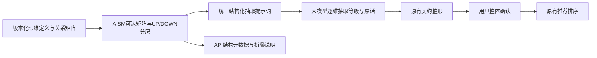

# AISM＋大模型：本地交付

用户要求撤回“大模型＋针对性规则核验＋异常确认”，改为“AISM 梳理维度关系，大模型按维度抽取”。本轮已完成本地实现与验收，未上传 GitHub、合并主线或发布公网。

## 回退情况

分支 `codex/aism-semantic-structure-20261028` 上，回退提交 `3592851` 撤销了 `d0810a5` 的新增规则核验模块、异常逐项勾选、错误注入演示及相关交付文件。历史提交仍可恢复。旧的字段/原话证据校验、预算来源检查、七维权重映射及用户整体确认保留。

## 新方案如何工作



- `semantic_aism.py` 实际计算邻接矩阵、带自反关系的布尔闭包、UP 结果端剥离、DOWN 输入端剥离、强连通组及缩点 DAG 的传递约简骨架。
- `data/aism-semantic-structure.json` 为可审查的初始结构。当前七维保持既有定义，只引入处理器→游戏、电池容量→游戏两条关系，其依据是已有 `catalog/spec_reference.py:reference_values` 的 `.8/.2` 游戏规格参考公式。
- 这些是**项目计算依赖**，不声称普遍物理因果、用户偏好传播或专家调研结论；未连边也不证明现实中完全无关。
- 当前 UP 剥离顺序：第1层重量/存储/屏幕尺寸/拍照/游戏，第2层电池容量/处理器；DOWN 顺序：第1层重量/存储/屏幕尺寸/拍照/电池容量/处理器，第2层游戏。层级不代表重要程度。
- 结构版本 `aism-seven-dimensions-v1`；算法版本 `aism-closure-up-down-v1`；结构摘要 `bc169c68875090dc113c628d95162267bdbf6b7bcca0192eb628dced98304b03`。提示词版本绑定该摘要，避免改模型却不能追溯。
- 通用 `LLMClassifier` 和正式 `OfficialNeedsClassifier` 的实际请求都使用同一份计算结构提示词。`/api/v1/meta` 和需求抽取返回相同结构快照；进程内固定，修改 JSON 后重启生效。
- 模型仍输出既有七维五档、参数和原话证据。AISM 不再另做一次语义抽取，不重写等级、不自动把游戏偏好加到处理器或电池上。
- 网页可展开“查看维度关系（AISM）”，没有新增异常逐项勾选。仍只需检查表单后进行原有整体确认。

初始结构仍需领域审阅与语义效果实验；`empirically_validated=false` 在配置、API 与界面中均明确保留。AISM 的结构组织不能单独判断原话是否支持抽取结果。

## 验证结果

| 检查 | 结果 |
|---|---|
| 应用全量回归 | 794 项通过，含新增14项 AISM/实际适配器/API测试 |
| 前端回归 | 50 项通过，含实际 app 处理器的结构展示、单次整体确认与权重不传播 |
| 数据管线 | 37 项通过，显式使用 `PHONE_CATALOG_DB=data/catalog.sqlite` |
| 独立发布包 | 模块及 JSON 随包交付；解压后可独立导入与排序，2项通过 |
| 真实 HTTP 推荐/导出 smoke | 40个可排名配置，CSV/XLSX/JSON 三种导出通过 |
| AISM需求→推荐HTTP | 模型摘要在 meta/抽取中一致；游戏/处理器/电池权重为9/2/2；24个配置满足预算与排除品牌条件 |
| 桌面/窄屏浏览器 | 1280×900 / 390×844；文档宽1270/380，无横向溢出；结构可展开，额外异常复选框数量0；已确认后真实生成推荐 |
| 独立审阅 | 未发现阻塞问题；审阅者以独立DFS/DAG实现穷举核对4,096个四节点有向图，闭包、双向层级、缩点约简均一致 |
| UI检测 / 版本校验 | UI检测 `[]`，`git diff --check` 与发布数据校验通过 |

旧 Streamlit 回归仍有已有弃用/ScriptRunContext 提示；没有借本轮改动修改旧入口或数据总体人工验收状态。

证据在 `local_evidence/`：`aism-full-tests-20261028.log`、`aism-frontend-tests-20261028.log`、`aism-pipeline-tests-20261028.log`、`aism-http-20261028.json`、`aism-browser-20261028.json`、`aism-{desktop,mobile}-20261028.png`、`aism-ui-detect-20261028.json`。

## 启动与效果边界

本地预览：<http://127.0.0.1:8617/>，使用普通离线夹具，不再注入错误，不调用付费模型。网页明确显示离线提示。可输入：

> 最多3000元，游戏最重要，不要苹果

```powershell
Set-Location 'C:\Users\zhang\Documents\ChatGPT\人工智能算法精英大赛\outputs\zhixuan-phone-recommender-v2'
.\.venv\Scripts\python.exe scripts/preview_aism_semantics.py --port 8617
```

正式入口仍为 `api.app:app`，沿用现有模型开关、服务端凭据及额度限制。真实请求提示词接入通过离线传输替身核验；本轮没有实际模型准确率、成本或幻觉率的对照实验，不把结构接入当作已证明效果提升。原始手机数据、七维权重及推荐算法保持既有定义，公网仍是之前发布的版本。
