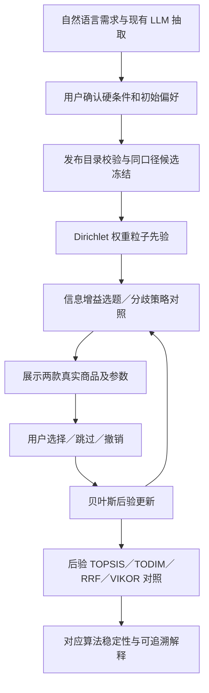

# 知选交互算法交接：从实验室接入网页

日期：2026-10-22。当前分支 `codex/competition-preference-fusion`，基于 v2 `21db545`。
当前交付是独立研究入口及算法包；云端 HTML/API 仍需单独集成与验收。

2026-10-24 补充：原实验提交 `b8cfd71` 已合入完整汇总分支 `codex/all-optimizations-20261024`，与最新主线网页代码共存。原分支和日期是本交接文档的历史上下文；当前上传范围见 [仓库同步说明](repository-sync-20261024.md)。

## 文件及职责

| 文件 | 队友需要了解的内容 |
|---|---|
| `algorithms/ranking.py` | 冻结可比候选，原 TOPSIS 等价、经典 TODIM、RRF、VIKOR Q |
| `algorithms/preference.py` | 粒子先验、回答似然、信息增益/分歧选题、撤销及重放 |
| `algorithm_lab.py` | 可运行的页面接入范例；不是当前生产 HTML 的入口 |
| `scripts/evaluate_competition.py` | 25 方法对照，留出手机对、同轨迹学习基线、配对区间 |
| `tests/test_competition_*.py`、`tests/test_algorithm_lab.py` | 数学手算、边界、会话生命周期及真实目录页面测试 |
| `docs/competition-algorithm-results.md` | 已运行结果、负结果、可用的比赛表述与研究限制 |

## 最小调用

```python
from pathlib import Path
from catalog.release import ReleaseStore
from catalog.adapter import build_input
from algorithms.ranking import DecisionProblem
from algorithms.preference import PreferenceSession, SessionConfig

release = ReleaseStore(Path('data/catalog.sqlite')).get()
needs = {'budget': {'min': 1000, 'max': 6000}, 'min_storage': 256}
weights = {'price': 5, 'weight': 2, 'storage': 2, 'refresh': 1}
di = build_input(release.repo, needs, weights, None, 'new')
session = PreferenceSession(DecisionProblem(di), SessionConfig(strategy='information'))
question = session.question()   # None 表示已无有效问题或达到上限
if question is not None:
    # 网页展示 question['a'] / ['b'] 对应的真实商品与有效指标。
    # 此处只演示用户确实提交 A 后的调用，不能自动替用户选择。
    session.answer(question['id'], 'a')
report = session.report()
ranked = sorted(report['ranking'], key=lambda row: -round(row['topsis'], 12))
# 所选排序对应的稳定性：row['stability']['topsis']。
# row['vikor_q'] 越小越好；row['vikor'] 为 1-Q，越大越好。
```

`initial_weights` 为启用指标的归一化参考；Dirichlet 先验额外加 1 做平滑，
未回答时的后验均值可能与参考权重不同。零权重指标被关闭，学习不会重新启用。
屏幕作为目标型指标启用时，必须给 `DecisionProblem` 和 `build_input` 传相同的已确认目标值。

## 网页接入顺序

1. 现有 LLM 先抽取需求；用户确认预算、指标及偏好后，再用 `build_input` 产生决策输入。
   预算/品牌/最低存储是硬条件，回答学习只改变有效指标权重，不能偷偷放宽硬条件。
2. 服务端为每位访客隔离保存一个 `PreferenceSession`。不把全局共享会话当作用户会话。
   关联目录发布版本、算法版本和确认条件；条件、数据或版本变化时重新开始。
3. `question()` 返回两款 SKU ID、信息增益、分歧值及问题 ID。展示原始参数和来源，
   不将刷新率、像素或处理器名替代真实游戏/拍照体验。
4. 回答只允许 `a/b/skip/indifferent`。服务端调用 `answer` 验证问题仍为当前问题，
   重复请求或过期问题返回可理解的提示，不重复学习。`undo()` 从先验重放剩余记录。
5. 推荐默认使用 `topsis` 的后验平均分；可以提供 VIKOR 与融合对照。
   名次/支持率必须来自同一条算法，不能把融合的稳定性写到 TOPSIS 推荐旁。
6. 解释生成继续沿用既有证据约束：输入真实参数、已确认需求、选择算法及排名，
   LLM 负责表达理由，不重新编造权重/商品参数、修改排序或把支持率说成满意概率。
7. 先本地联合测试，再创建团队 PR；核对服务器实际部署仓库、分支、入口与提交后发布。
   当前提交基线早于其他工作目录中的未提交网页改动，不能用整个旧目录覆盖新界面。



## 验收与比赛边界

本地启动、确认、连续回答、下一题不继承旧答案、跳过、撤销、变更预算使会话失效，
以及切换展示算法不篡改后验，都应实际操作验收。导出含算法版本、配置、回答及决策指纹。
核心模块升级后重启 Python 服务；开发热更新不保证已加载模块自动全部重载。

当前可称为“主动偏好获取与多准则决策对照框架”。贝叶斯、TOPSIS、TODIM、RRF、VIKOR
都是已有方法；组合、工程实现及实证分析是本项目工作。当前没有训练深度网络，
不能将其写成“深度学习推荐模型”，也不能把合成准确率当成真实消费者准确率。
